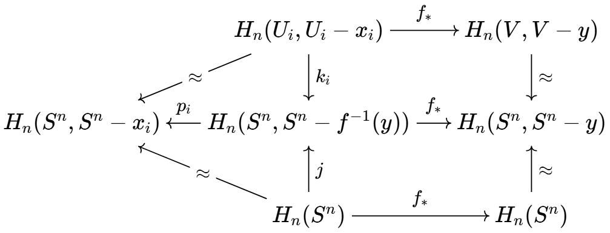

+++
title = "同调论（二）：计算方法与应用"
draft = true

[extra]
math = true

[taxonomies]
categories = ["知识"]
tags = ["数学", "拓扑学"]
+++

## 度
### 定义
对 $f: S^n \to S^n$，其诱导的 $f_\ast: H_n(S^n) \to H_n(S^n)$ 是 $\Z$ 到自身的同态，必形如 $f_\ast(\alpha) = d\alpha$，记 $d = \deg f$ 为 $f$ 的**度**。

易见 $\deg (fg) = \deg f \deg g$；若 $f$ 不满，则取不在其像中的 $x_0$，可作分解 $S^n \to S^n - \set{x_0} \hookrightarrow S^n$，从而 $f$ 度为零。

我们有 $f \simeq g$ 当且仅当 $\deg f = \deg g$，其中右推左是 Hopf 给出的同伦论结论。对于同伦等价 $f$，$fg \simeq \mathbf 1$ 给出 $\deg f \deg g = \deg \mathbf 1 = 1$，从而 $\deg f = \pm 1$.

对 $S^n$ 上的镜像对称，可算得其度为 $-1$，故对径映射度为 $(-1)^{n+1}$；对没有不动点的映射 $f$，有以下同伦，故度一定为 $(-1)^{n+1}$：

$$f_t(x) = \frac{(1 - t) f(x) - tx}{|(1 - t) f(x) - tx|}$$


考虑嵌入 $\R^{n+1}$ 的看法，假设有非零连续向量场 $V$，不妨让 $|V(x)| = 1$，令：

$$f_t(x) = (\cos t)x + (\sin t)V(x)$$

让 $t$ 从 $0$ 走到 $\pi$，它给出从恒等映射到对径点映射的同伦，故它们度相同，$(-1)^{n+1} = 1$，$n$ 偶。

$n$ 为奇时只需取：

$$V(x_1, \dots, x_{2k}) = (-x_2, x_1, \dots, -x_{2k}, x_{2k-1})$$



$n$ 为偶时 $\Z_2$ 是唯一能自由作用（非平凡元没有固定点）在 $S^n$ 上的非平凡群。


设群是 $G$，由于同胚的度是 $\pm 1$，有一个 $d: G \to \set{\pm 1}$ 是同态。如果作用是自由的，则 $d$ 把每个非平凡元打到 $(-1)^{n+1} = -1$，故只有 $\Z_2$.

### 计算技术
设 $f: S^n \to S^n$ 对于某个点 $y \in S^n$，其原像是有限个点 $x_1, \dots, x_m$，其不交的邻域 $U_i$ 满足 $f(U_i - \set{x_i}) \subseteq V - \set{y}$，则有：

这里 $k_i, p_i$ 是嵌入诱导的，上面两个同构来自切除引理，下面两个同构来自正合列。最上面两个群同构与 $\mathbb Z$，称 $f_\ast$ 对应的整数是**局部度** $\deg f|_{x_i}$，一般其符号容易确定。


$$\deg f = \sum_i \deg f|_{x_i}$$


由切除引理，$H_n(S^n, S^n - f^{-1}(y))$ 是所有 $H_n(U_i, U_i - x_i)$ 的直和，$k_i$ 给出嵌入，$p_i$ 给出投射。

由 $p_i(j(1)) = 1$，有 $j(1) = (1, \dots, 1) = \sum_i k_i(1)$，又 $f_\ast$ 将 $k_i(1)$ 打到 $\deg f|_{x_i}$，故成立。

现在可以构造任意度的 $f: S^n \to S^n$，用 $\bigwedge_k S^n$ 指代：在 $S^n$ 上找 $k$ 个不交的开球，将除此之外的东西捏成一个点得到的东西，相当于是 $k$ 个 $S^n$ 的一点并。于是有商映射 $p: S^n \to \bigwedge_k S^n$，然后让 $q: \bigwedge_k S^n \to S^n$ 是将不同的 $S^n$ 部分映到同一个 $S^n$ 上。


悬挂 $SX$ 是指 $X \times [0, 1]$ 的顶、底缩成一个点得到的东西，$f \times \mathrm{id}_I$ 诱导 $Sf$；可以将 $f: S^n \to S^n$ 的悬挂看成 $Sf: S^{n+1} \to S^{n+1}$，此时有：

$$\deg Sf = \deg f$$

