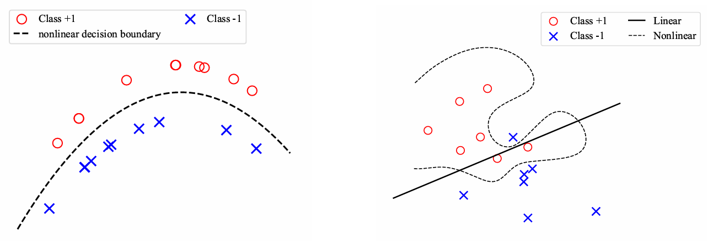
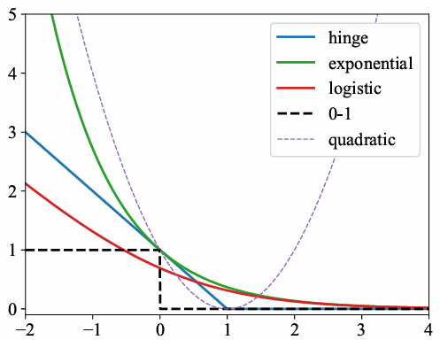
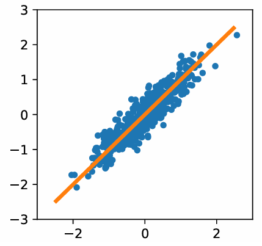

+++
title = "机器学习（二）：分类；无监督学习"
date = 2026-10-28
updated = 2026-11-05

[extra]
math = true

[taxonomies]
categories = ["知识", "课程"]
tags = ["计算机"]
+++

一些剩余的传统机器学习方法，对应于[教师 Lecture Notes](https://leiwu0.github.io/courses/mi2ml/index.html) 的 Lecture 3, 4.

<!-- more -->

## 分类
### 数学理解
与回归不同的是，分类的 label 是“类型”（category），这里用整数指代：

$$[c] \coloneqq \set{1, \dots, c}$$

分类误差（classification error）是：

$$R(f) = \mathbb E_{\mathbf x, y}[l_{\text{0-1}}(f(\mathbf x), y)]$$

我们想要最小化的经验误差也就是：

$$\min_f \frac 1 n \sum_{i=1}^n l_{\text{0-1}}(f(\mathbf x_i), y_i) + \lambda \Omega(f)$$

这里 $l_{\text{0-1}}(y, y') = 1 - \delta_{y, y'}$，但这个损失函数不适合计算，因此通常使用一些代理损失函数（surrogate loss）$l$，要求的是 $l$ 光滑及 $l$ 小推出 $l_{\text{0-1}}$ 小。

### 概率模型
概率模型考虑的是软标签（soft label），即每个 $p(\mathbf x)$ 在 $c-1$ 维单形中：

$$p(\mathbf x) = (p_1(\mathbf x), \dots, p_n(\mathbf x)) \in \Delta^{c-1}$$

$$y \sim \mathrm{Categorical}(p(\mathbf x))$$

我们需要选定一个将“逻辑值” （logits）$f_\theta$ 转为 $F_\theta$ 的函数。

$$
F_\theta: \mathcal X \to \Delta^{c-1} \\\\
f_\theta: \mathcal X \to \R^c
$$

最常见的选择是 softmax，很多分类任务是比较有确定性的，指数强调了这一点：

$$\mathrm{softmax}(\mathbf z) = \left(\frac{e^{z_1 / T}}{\sum e^{z_i / T}}, \dots, \frac{e^{z_c / T}}{\sum e^{z_i / T}}\right)$$

我们的优化目标就是：

$$\min_\theta \frac 1 n \sum_{i=1}^n d(p(\mathbf x_i), F(\mathbf x_i; \theta))$$

记 one-hot label $\mathbf e_y = (0, \dots, 0, 1, 0, \dots, 0)$，我们实际上的优化目标是：

$$\min_\theta \frac 1 n \sum_{i=1}^n d(\mathbf e_{y_i}, F(\mathbf x_i; \theta))$$

就像回归中的标签也有噪声，只不过无偏一样，用 $\mathbf e_{y_i}$ 没有什么问题。有时采取 label smoothing：

$$\left(\frac{\delta}{c-1}, \dots, \frac{\delta}{c-1}, 1 - \delta, \frac{\delta}{c-1}, \dots, \frac{\delta}{c-1}\right)$$

这里的 $d$ 是“散度”（divergence），并不完全是距离。常用的是 KL 散度：

$$d_{\text{KL}}(p, q) = \sum p_i \log \frac{p_i}{q_i}$$

使用交叉熵（cross-entropy）来看，这就是 $H(P, Q) - H(P)$，其中 $H(P, Q)$ 是用预测分布 $Q$ 来编码真实分布 $P$ 所需信息量：

$$H(P, Q) = -\sum_i P(\mathbf x_i) \log Q(\mathbf x_i)$$

使用这个散度，优化目标就是：

$$\min -\frac 1 n \sum_{i=1}^n \left(\sum_{j=1}^c y_{i, j} \log F_j(\mathbf x_i; \theta)\right)$$

如果用的是 one-hot label 就是：

$$\min -\frac 1 n \sum_{i=1}^n \log F_{y_i}(\mathbf x_i; \theta)$$

这实际上就是极大似然估计（Maximize Likelihood Estimation, MLE）。极大似然估计是一个一般的方法：假设 $\mathbf z \sim P_\theta$，生成了数据 $(\mathbf z_1, \dots, \mathbf z_n)$，看什么样的 $\theta$ 最有可能生成这组数据。我们要：

$$
\max \prod_{i=1}^n P_\theta(\mathbf z_i) \iff
\max \sum_{i=1}^n \underbrace{\log P_\theta(\mathbf z_i)}_{\text{likelihood}}
$$

现在热门的 Next-token prediction (NTP) 本质上也就是此：

$$\max_\theta \sum_{j=1}^n \sum_{i=1}^l \log F_{\mathbf x_{i+1}^{(j)}}(\mathbf x_{\leq i}^{(j)}; \theta)$$

### 几何模型：支持向量机
想象空间中有两团数据（相较于概率模型，几何模型无法自然地推广到多分类），我们用一个超平面把它们分开。超平面即：

$$H_\theta = \set{\mathbf x | \mathbf w^\top \mathbf x + b = 0}$$

对于预测的信心、几何间隔（geometric margin）是：

$$d(\mathbf x, H_\theta) \coloneqq \inf_{\mathbf x' \in H_\theta} \lVert\mathbf{x - x'}\rVert = \frac{|w^\top \mathbf x + b|}{\lVert w \rVert}$$

除了将两团分开外，还有一个直观是：扰动后数据仍不容易越过超平面。因此考虑最大化最小间隔。不去最大化平均间隔，因为它对于不均衡的数据等情况结果不太合理；而前者稀疏、能转化为凸优化问题。

我们的优化目标即（$y_i = \pm 1$）：

$$\max_{\mathbf w \in \mathbb S^{d-1}, b} \min_i |\mathbf w^\top \mathbf x_i + b| \text{ s.t. } (\mathbf w^\top \mathbf x_i + b) y_i \geq 0$$

令 $t = \min_i |\mathbf w^\top \mathbf x_i + b|$，那么（假设线性可分）等价于：

$$\max_{\mathbf w \in \mathbb S^{d-1}, b} t \text{ s.t. } (\mathbf w^\top \mathbf x_i + b) y_i \geq t$$

将 $\mathbf w, b$ 同除以 $t$，则可等价于：

$$\min_{\mathbf w, b} \lVert \mathbf w \rVert^2 \text{ s.t. } (\mathbf w^\top \mathbf x_i + b) y_i \geq 1$$

我们称 $(\hat{\mathbf w}^\top \mathbf x_i + \hat b) y_i = 1$ 的点为支持向量（support vector），它们是真正决定结果的点。直观上，更少的支持向量能带来更好的泛化能力。

---

如果数据不线性可分，则有如下两种方法：

第一种是非线性地分，放到更大的特征空间中用支持向量机分开。这也是核方法在机器学习中被推动的重要因素。记某个正则化 $\Omega: \mathcal F \to \R_{\geq 0}$，所做就是：

$$\min \Omega(f) \text{ s.t. } f(\mathbf x) y_i \geq 1$$

第二种就是 soft margin，允许少量数据有错。

$$\min \lambda \Omega(f) + \frac 1 n \sum_{i=1}^n \xi_i \text{ s.t. } f(\mathbf x_i) y_i \geq 1 - \xi_i, \\, \xi_i \geq 0$$

记 $l(z) = \max(0, 1 - z)$，就可等价于如下无约束问题：

$$\min_f \frac 1 n \sum_{i=1}^n l(f(\mathbf x_i) y_i) + \lambda \Omega(f)$$

我们可以形成的一般准则（margin/confidence-based principle）是：信心高时应降低惩罚。

这里代理损失函数有很多种选择：

其中 logistic 是：

$$l(z) = \log(1 + e^{-z}) = \begin{cases} e^{-z} & z \gg 1 \cr -z & z \ll 1 \end{cases}$$

## 无监督学习
### 数学理解
无监督学习有两类，传统的那一类 discriminative 是对于分布 $\rho^\ast$ 生成 $\mathbf x_i \stackrel {\text{iid}} \sim \rho^\ast$，根据 $\mathbf x_1, \dots, \mathbf x_n$ 推导 $\rho^\ast$ 的某些性质；另一类 generative 则是生成某些 $\\{\tilde{\mathbf x_j}\\}_{j=1}^m$.

第一类中方法有：密度估计（density estimation）希望得到 $\hat \rho_n \approx \rho^\ast$；降维（dimension reduction）希望找到低维结构；聚类（clustering）。

### 密度估计
第一种方法是直方图（histogram estimate）。假设 $\mathbf x_i \in [0, 1]^d = I$，将 $I$ 划分成 $h^d$ 个网格 $I_j$，每个网格有 $n_j$ 个样本点。那么平凡地：

$$\hat \rho_h(\mathbf x) = \sum_j \frac{n_j}{nh^d} \mathbf 1_{I_j}(\mathbf x)$$

第二种方法是核密度估计（kernel density estimator, KDE），使用：

$$\hat \rho_n(\mathbf x) = \frac 1 n \sum_i K_h(\mathbf x - \mathbf x_i)$$

定义 $K$ 是 smoothing kernel 如果 $K \geq 0$、积分为 $1$ 且对称 $K(\mathbf x) = K(-\mathbf x)$，常见的选取有 Box、Triangular 及 Gaussian；然后取带宽（bandwidth）$h$，令：

$$K_h(\mathbf x) = h^{-d} K\left(\frac {\mathbf x} h\right)$$

现在来估计误差，使用 variance-bias 分解（$\mathbb E[Z^2] = (\mathbb EZ)^2 + \mathbb E[(Z - \mathbb EZ)^2]$），设 $\rho_h(\mathbf x) = \mathbb E_S[\hat \rho_h(\mathbf x)]$：

$$\mathbb E_S[(\hat \rho_h(\mathbf x) - \rho^\ast(\mathbf x))^2] = (\underbrace{\mathbb \rho_h(\mathbf x) - \rho^\ast(\mathbf x))^2}_{\text{bias}} + \mathrm{Var}(\hat \rho_h(\mathbf x))$$

则由如下推导（使用积分为 $1$ 与对称性）知 $\text{bias} \eqsim h^4$：

$$
\begin{split} \rho_h(\mathbf x) - \rho^\ast(\mathbf x)
&= \mathbb E_{\mathbf x' \sim \rho^\ast}[K_h(\mathbf{x - x'})] - \rho^\ast(\mathbf x) \cr
&= \int K_h(\mathbf{x - x'}) \rho^\ast(\mathbf x') \mathrm d\mathbf x' - \rho^\ast(\mathbf x) \cr
&= \int K(\mathbf z) (\rho^\ast(\mathbf x + h\mathbf z) - \rho^\ast(\mathbf x)) \mathrm d\mathbf z \cr
&= \int K(\mathbf z) (h\braket{\nabla \rho^\ast(\mathbf x), \mathbf z} + h^2 \mathbf z^\top \nabla^2 \rho^\ast(x)\mathbf z + o(h^2)) \mathrm d\mathbf z \cr
&= h^2 \int K(\mathbf z) \mathbf z^\top \nabla^2 \rho^\ast(x)\mathbf z \mathrm d\mathbf z + o(h^2)
\end{split}
$$

相应地，对于方差有下式，从而产生 tradeoff：

$$\text{variance} = \frac 1 {nh^d} \int K^2(\mathbf z) \rho^\ast(\mathbf x + h\mathbf z) \mathrm d\mathbf z$$

故而，我们希望最小化 $h^4 + 1 / hd^n$，大概希望 $\hat h_{\text{opt}} = cn^{- 1 / (d+4)}$，这里的常数我们不知道，可以用一些小模型来尝试。又，这里可知此方法有维数灾难，只适合低维（$\leq 3$）。

### 降维
线性降维的经典方法是主成分分析（PCA, principal component analysis），这假设数据在某个低维子流形上。

先归一化到重心是原点，考虑投影到 $1$ 维，最大化投影的方差：

$$\max_{\lVert\mathbf w\rVert = 1} \frac 1 n \sum_{i=1}^n (\mathbf x_i^\top \mathbf w)^2$$

令协方差（covariance）$\hat \Sigma = \sum \mathbf x_i \mathbf x_i^\top / n$，即：

$$\max_{\lVert\mathbf w\rVert = 1} \mathbf w^\top \hat \Sigma \mathbf w$$

这个最大值是最大特征值，此时 $\mathbf w$ 是对应特征向量（称为第一个主成分方向 $\text{PC}_1$）。

把这个方法推广到 $k$ 维，设 $W = (\mathbf w_1, \dots, \mathbf w_k) \in \R^{n \times k}$，假设 $W^\top W = I_k$，则：

$$\max_{W^\top W = I_k} \sum_{\alpha=1}^k \mathbf w_\alpha^\top \hat \Sigma \mathbf w_\alpha$$

方差最大化也可看成最小化重构误差，即：

$$\min_W \lVert X - XWW^\top\rVert$$

自编码器（autoencoder）说的是可非线性的降维-还原映射。但非线性降维的方法在今日看大多不好用，因为非线性，难以从降维结果推测原本的性质。

---

现在来看随机投影（random projection），想法是找一个 $f: \R^d \to \R^k$ 大致满足：

$$1 - \varepsilon \leq \frac{\lVert f(\mathbf x_i) - f(\mathbf x_j) \rVert}{\lVert \mathbf x_i - \mathbf x_j \rVert} \leq 1 + \varepsilon$$

后来人们发现，实际上只要取成：

$$f(\mathbf x) = \frac 1 {\sqrt k} W\mathbf x, W \in \R^{k \times d}, w_{ij} \sim N(0, 1)$$


设 $\mathbf x_1, \dots, \mathbf x_n$ 是 $\R^d$ 中样本，给定 $\delta \in (0, 1)$，令 $k_\varepsilon = 6\log(2n/\delta)/\varepsilon^2$，对于 $k \geq k_\varepsilon$，在 $W$ 的随机采样上有 $1 - \delta$ 的概率：

$$\max_{i \in [n]} \left|\frac{\lVert \frac 1 {\sqrt k} W\mathbf x_i \rVert_2^2}{\lVert \mathbf x_i \rVert_2^2} - 1\right| \leq \varepsilon$$


不失一般性假设 $\lVert \mathbf x_i \rVert_2 = 1$，设 $W = (\mathbf w_1, \dots, \mathbf w_k)^\top$，则 $\mathbf w_j^\top \mathbf x \sim N(0, 1)$，有：

$$\mathbb E[\lVert \frac 1 {\sqrt k} W\mathbf x \rVert_2^2] = \frac 1 k \sum_{j=1}^k \mathbb E[|\mathbf w_j^\top \mathbf x|^2] = 1$$

使用集中不等式，有：

$$P\left(\left|\frac 1 k \sum_{j=1}^k |\mathbf w_j^\top \mathbf x|^2 - 1\right| \geq \varepsilon\right) \leq 2e^{-k\varepsilon^2/6}$$

$$P\left(\max_{i \in [n]} \left|\frac 1 k \sum_{j=1}^k |\mathbf w_j^\top \mathbf x|^2 - 1\right| \geq \varepsilon\right) \leq n2e^{-k\varepsilon^2/6}$$

回忆没有免费的午餐定理，这种方法能够使用用到的性质是降到的维数只能 $\propto \log n$.

### 聚类
聚类想做的是把数据集分成几个集合的无交并，在同一个集合中的点相似。

$k$-均值算法是：设类 $C_1, \dots, C_k$，每个类中心 $\alpha_k = \sum \mathbf x_j / |C_k|$，目标函数是：

$$
\begin{split} I(C_1, \dots, C_k)
&= \frac 1 2 \sum_{k=1}^K \frac 1 {|C_k|} \sum_{i, j \in C_k} \lVert \mathbf x_i - \mathbf x_j \rVert^2 \\\\
&= \sum_{k=1}^K \sum_{j \in C_k} \lVert \mathbf x_j - \alpha_k \rVert^2 \\\\
&= \min_\beta \sum_{k=1}^K \sum_{j \in C_k} \lVert \mathbf x_j - \beta_k \rVert^2
\end{split}
$$

使用迭代的方法计算（这是一般的找 $\min f(x, y)$ 方法的特例）：

$$
C^{t+1} \leftarrow \argmin I(C, \beta^t) \\\\
\beta^{t+1} \leftarrow \argmin I(C^{t+1}, \beta)
$$

这里第一步称为 assignment，第二步称为 update，因为本质上最优的 $\beta_k$ 就是中心。初始的 $\beta^0$ 可能需要选多次。

---

概率分类给每个点属于某个类分配概率。Gaussian mixture model (GMM) 假设：

$$p(\mathbf x) = \sum_{k=1}^K \pi_k N(\mathbf x|\mu_k, \sigma_k) \quad \pi_k \geq 0, \sum_{k=1}^K \pi_k = 1$$

这里理解为有某个隐变量 $z$，

$$
z \sim \mathrm{Categorical}(\pi_k) \\\\
p(\mathbf x) = \sum_z p(\mathbf x|z)p(z)
$$

在 $k$-均值中 $\mathbf x$ 的标签是 $\argmin_k \lVert x - \alpha_k \rVert$，而 GMM 中是 $\mathbf x$ 在第 $k$ 类的概率：

$$\gamma_x(k) = p(z = k | \mathbf x) = \frac{\pi_k \phi(\mathbf x; \mu_k, \sigma_k)}{\sum_{z=1}^k \pi_z \phi(\mathbf x; \mu_z, \sigma_z)}$$

其中 $\phi(\cdot; \mu_k, \sigma_k)$ 是 $N(\mu_k, \sigma_k)$ 的密度函数。

最大期望（Expectation-Maximization, EM）算法就是假设 $\mathbf x_i \stackrel {\text{iid}} \sim p(\cdot | \theta)$，去进行 MLE：

$$\max \prod_{i=1}^n p(\mathbf x_i | \theta) \iff \min -\sum_{i=1}^n \log p(\mathbf x_i | \theta)$$

这是一个典型的隐变量模型（latent state model）。这个结果无法用于密度估计，因为每一类是 Gauss 的不太可能；但是 Gauss 的等高线是椭圆，可以聚类。
