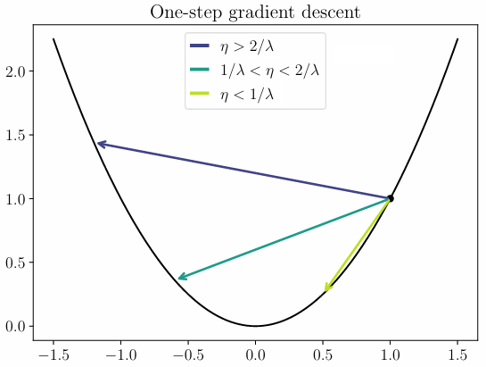
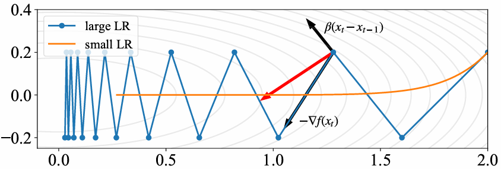
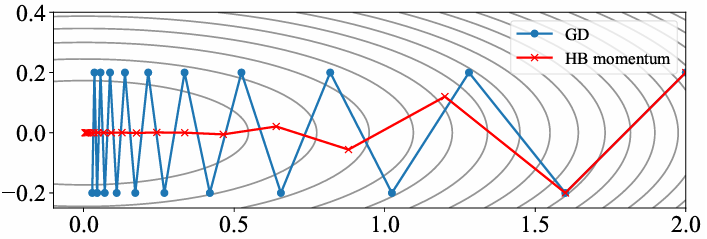

+++
title = "机器学习（三）：优化方法"
draft = true

[extra]
math = true

[taxonomies]
categories = ["知识", "课程"]
tags = ["计算机"]
+++

## 问题建立
对目标函数 $f: \Omega \to \R$，优化即可行域 $\Omega$ 中 $\inf_{x \in \Omega} f(x)$，我们一般希望把有约束的区域 $\Omega$ 重新 formula 成无约束的版本。

在大多数应用场景中，优化命题无法给出闭式解，只能使用迭代法。最典型的就是梯度下降（gradient descent, GD）：

$$x_{t+1} = x_t - \eta_t \nabla f(x_t)$$

常见的收敛指标包括：
- 点的收敛：$x_t \to x^\ast$
- 函数值的收敛：$f(x_t) \to f(x^\ast)$
- 梯度的收敛：$\lVert \nabla f(x_t) \rVert \to 0$

由于 $f$ 可能复杂，一般不使用点的收敛；又因为我们并不知道 $f(x^\ast)$ 是什么，故用梯度趋于零（尽管非凸问题中不一定达到全局最小值）。

## 梯度下降
### 下降的分析
这里 $\eta_k$ 称为**学习率**/步长（learning rate / step size），常用的调整学习率的方法有：
- line search $\eta_t = \argmin_{\eta \geq 0} f(x_t - \eta \nabla f(x_t))$：在古典数值优化中常用但机器学习很少用
- 常值学习率：最常用
- 学习率衰减 $\eta_t = \eta_0 / (1 + t)$：常用于非凸的 $f$

考虑 $f(x) = |x|$，使用常值学习率会导致在原点附近反复震荡。

将梯度下降的更新重写为：

$$\frac{x_{t+1} - x_t}{\eta} = -\nabla f(x_t)$$

将其连续化就得到梯度流（gradient flow）：

$$\dot x_\tau = -\nabla f(x_\tau)$$

沿着梯度流，就有目标函数单调不增：

$$\frac{\mathrm df(x_t)}{\mathrm dt} = \braket{\nabla f(x_t), \dot x_t} = -\lVert \nabla f(x_t) \rVert^2 \leq 0$$

对于离散的情况，设 $\eta \leq 1 / \mathrm{Lip}(f)$，就有：

$$
\begin{split} f(x_{t+1})
&= f(x_t - \eta \nabla f(x_t)) \\\\
&= f(x_t) - \eta \lVert \nabla f(x_t) \rVert^2 + \frac{\eta^2}{2} \braket{\nabla f(x_t), \nabla^2 f(\xi_t) \nabla f(x_t)} \\\\
&\leq f(x_t) - \eta \lVert \nabla f(x_t) \rVert^2 + \frac{\eta^2}{2} \lVert \nabla f(x_t) \rVert^2 \sup_{\xi_t} \lVert \nabla^2 f(\xi_t) \rVert \\\\
&\leq f(x_t) - \frac{\eta}{2} \lVert \nabla f(x_t) \rVert^2 \tag{*}
\end{split}
$$

考虑二次函数 $f(x) = \lambda x^2/2$，则有 $x_t = (1 - \eta \lambda)^t x_0$，

我们可以将 $(\ast)$ 式稍作修改，得到平均梯度以 $\sqrt k$ 收敛：

$$\sqrt{\frac 1 k \sum_{t=0}^{k-1} \lVert \nabla f(x_t) \rVert^2} \leq \sqrt{\frac{2 (f(x_0) - f(x^\ast))}{k \eta}}$$

### 凸函数分析
我们记全局最小值点集：

$$S_f = \set{x | f(x) = \inf_x f(x)}$$

使用凸性与之前 $(\ast)$ 式可以推导：

$$
\begin{split} f(x_{t+1}) - f(x^\ast)
&\leq f(x_t) - f(x^\ast) - \frac{\eta}{2} \lVert \nabla f(x_t) \rVert^2 \\\\
&\leq \braket{x_t - x^\ast, \lVert \nabla f(x_t) \rVert} - \frac{\eta}{2} \lVert \nabla f(x_t) \rVert^2 \\\\
&= - \frac 1 {2\eta} [\lVert x_t - x^\ast - \eta \nabla f(x_t) \rVert^2 - \lVert x_t - x^\ast \rVert^2] \\\\
&= - \frac 1 {2\eta} [\lVert x_{t+1} - x^\ast \rVert^2 - \lVert x_t - x^\ast \rVert^2]
\end{split}
$$

$$f\left(\frac 1 n \sum_{k=0}^{N-1} x_k\right) - f(x^\ast) \leq \frac 1 n \sum_{k=0}^{N-1} f(x_k) - f(x^\ast) \leq \frac{\lVert x_0 - x^\ast \rVert^2}{2\eta N}$$

考察 $f(x) = x^{-\alpha}$，求解梯度流有 $y_t = (1 + Ct)^{-\alpha/(2 + \alpha)}$，因为 $x^\ast$ 在无穷远，损失 $\propto 1/N$ 的理解失效。

### KL 分析

称 $f \in C^1(\R^d)$ 满足 KL 条件，如果存在 $\mu > 0$，

$$\lVert \nabla f(x) \rVert^2 \geq 2\mu (f(x) - \inf_x f(x))^\alpha$$


若 $f$ 满足 KL 条件，则其所有驻点都是全局最小值点。这个条件在 $\alpha = 1$ 时称为 Polyak–Lojasiewicz (PL) 条件，其给出：

$$f(x_t) - \inf_x f(x) \leq e^{-2\mu t} (f(x_0) - \inf_x f(x))$$

如果 $f$ 满足以下的强凸性，则自动满足 PL 条件：

$$f(y) \geq f(x) + \braket{\nabla f(x), y - x} + \frac{\mu}{2} \lVert y - x \rVert^2$$

但 PL 条件实际上比强凸性弱很多。如 $x^2 + 3\sin^2 x$ PL 但非凸。另一个例子是：

$$F(\beta) = \frac 1 n \sum_{i=1}^n (\Phi(x_i)^\top \beta - y_i)^2 = \frac 1 n \lVert \Phi(X) \beta - y \rVert^2$$

### 二次函数
考虑一个简单的二次函数目标（$\varepsilon \ll 1$）：

$$f(x, y) = \frac 1 2 x^2 + \frac 1 {2\varepsilon} y^2$$

$$
\begin{cases}
    x_{t+1} = x_t - \eta x_t \\\\
    y_{t+1} = y_t - \frac{\eta}{\varepsilon} y_t
\end{cases} \implies
\begin{cases}
    x_t = (1 - \eta)^t x_0 \\\\
    y_t = (1 - \frac{\eta}{\varepsilon})^t y_0
\end{cases}
$$

回忆一维二次函数有稳定性边界（edge of stability）现象，需要 $\eta < 2/\lambda$，这使得这里需要 $\eta < 2\varepsilon$，于是学习率被 $\lambda$ 最大方向约束，而收敛又取决于 $\lambda$ 最小方向。

考虑一般的二次函数 $\min x^\top Hx/2$，设 $H = \sum_{j=1}^d \lambda_j u_j u_j^\top$，其中 $\lambda_1 \geq \cdots \geq \lambda_d$，定义**条件数** $\kappa = \lambda_1/\lambda_d$，有：

$$x_t = \sum_{j=1}^d (1 - \eta\lambda_j)^t \alpha_j(0) u_j$$

$$f(x_t) \lesssim \left(\frac{\kappa - 1}{\kappa + 1}\right)^{2t} \approx e^{-t / \kappa}$$

于是，达到 $\varepsilon$ 所需的迭代数有下式，知条件数是优化困难的一个重要来源：

$$T_\varepsilon = O(\kappa \log (1 / \varepsilon))$$

## 动量法
### Heavy-ball 方法
Polyak 提出的 Heavy-ball 方法是：

$$x_{t+1} = x_t - \eta \nabla f(x_t) + \beta(x_t - x_{t-1})$$

其在更新时的操作顺序即：

$$
\begin{cases}
    v_k = (x_k - x_{k-1}) / \eta \\\\
    v_{k+1} = \beta v_k - \nabla f(x_k) \\\\
    x_{k+1} = x_k + \eta v_{k+1}
\end{cases}
$$

$$v_{k+1} = \beta^k \nabla f(x_0) + \cdots + \nabla f(x_k)$$

如果我们设 $\beta = 1 - \alpha$，就可以推导出：

$$\frac{\frac{x_{k+1} - x_k}{\sqrt \eta} - \frac{x_k - x_{k-1}}{\sqrt \eta}}{\sqrt \eta} = -\nabla f(x_k) - \frac{\alpha}{\sqrt \eta} \frac{x_k - x_{k-1}}{\sqrt \eta}$$

连续化之后得到的就是 Newton 方程（$f(\cdot)$ 是潜能，$-\gamma V$ 是阻力）：

$$
\begin{cases}
    \dot X = V \\\\
    \dot V = -\gamma V - \nabla f(x)
\end{cases}
$$

于是我们可以作出解释：这个方法可以越过一些较浅的局部最小值点。但物理学直观还不足以说明为什么能减小 $T_\varepsilon$.

可以在 <https://distill.pub/2017/momentum/> 看到一个在线演示。

同样考虑多维二次函数，沿用之前记号，这里有：

$$\alpha_j(t + 1) = (1 + \beta - \eta \lambda_j) \alpha_j(t) - \beta \alpha_j(t - 1)$$

为此考虑其特征方程：

$$z^2 - (1 + \beta - \eta \lambda_j) z + \beta = 0$$

于是可以给出解：

$$
z_{j, \pm} = \frac{1 + \beta - \eta \lambda_j \pm \sqrt{\Delta_j}}{2} \\\\
\alpha_j(t) = C_+ z_{j, +}^t + C_- z_{j, -}^t
$$

$\beta$ 接近 $0$ 时这和 GD 没有很大区别。但接近 $1$ 时就有很大不同。考虑 $\Delta_j < 0$，这需要：

$$(1 - \sqrt \beta)^2 \leq \eta \lambda_j \leq (1 + \sqrt \beta)^2$$

此时，$z_+ = \overline{z_-}$，有：

$$\alpha_j(t) = |z|^t (C_1 \cos (at) + C_2 \sin (bt))$$

且 $|z_+| = |z_-| = \sqrt \beta$，条件在最大最小方向取等可以取：

$$\sqrt \beta = \frac{\sqrt \kappa - 1}{\sqrt \kappa + 1}, \quad \eta = \frac{2(1 + \beta)}{\lambda_1 + \lambda_d}$$

于是就有以下结果，相比 GD 对条件数的依赖多了一个根号：

$$|\alpha_j(t)| \lesssim \left(\frac{\sqrt \kappa - 1}{\sqrt \kappa + 1}\right)^t \approx e^{-t / \sqrt \kappa}$$

$$T_\varepsilon = O(\sqrt \kappa \log (1 / \varepsilon))$$

### Nesterov 方法
GD 与 HBM 的收敛速率都是 $O(1/t)$，这自然引出了能否通过惯性得到快于 $O(1/t)$ 的收敛速率的问题。

其中考虑的一般框架是：

$$x_{t+1} = \mathcal M(\nabla f(x_t), \dots, \nabla f(x_0), x_0)$$
