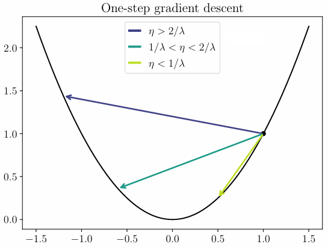
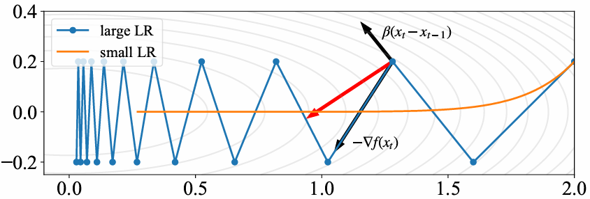
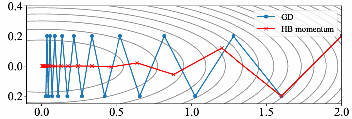

+++
title = "机器学习（三）：优化方法与分析"
date = 2026-11-12
updated = 2026-11-21

[extra]
math = true

[taxonomies]
categories = ["知识", "课程"]
tags = ["计算机"]
+++

简要介绍优化方法并作分析，对应于[教师 Lecture Notes](https://leiwu0.github.io/courses/mi2ml/index.html) 的 Lecture 5, 6；教师在随机梯度下降部分另外宣传了其近期的 [Functional Scaling Law](https://arxiv.org/abs/2509.19189) 工作。

<!-- more -->

## 问题建立
对目标函数 $f: \Omega \to \R$，优化即可行域 $\Omega$ 中 $\inf_{x \in \Omega} f(x)$，我们一般希望把有约束的区域 $\Omega$ 重新 formula 成无约束的版本。

在大多数应用场景中，优化命题无法给出闭式解，只能使用迭代法。最典型的就是梯度下降（gradient descent, GD）：

$$x_{t+1} = x_t - \eta_t \nabla f(x_t)$$

常见的收敛指标包括：
- 点的收敛：$x_t \to x^\ast$
- 函数值的收敛：$f(x_t) \to f(x^\ast)$
- 梯度的收敛：$\lVert \nabla f(x_t) \rVert \to 0$

由于 $f$ 可能复杂，一般不使用点的收敛；又因为我们并不知道 $f(x^\ast)$ 是什么，故用梯度趋于零（尽管非凸问题中不一定达到全局最小值）。

---

为后文准备，我们定义：称一个 $C^1$ 函数 $f$ 是 $L$-光滑的，如果恒有 $\lVert\nabla f(x) - \nabla f(y)\rVert \leq L \lVert x - y \rVert$，其基本结论：


$$f(y) \leq f(x) + \braket{\nabla f(x), y - x} + \frac L 2 \lVert y - x \rVert^2$$


## 梯度下降
### 下降的分析
这里 $\eta_k$ 称为**学习率**（learning rate, LR）或步长（step size），常用的调整学习率的方法有：
- line search $\eta_t = \argmin_{\eta \geq 0} f(x_t - \eta \nabla f(x_t))$：在古典数值优化中常用但机器学习很少用
- 常值学习率（constant LR）：最常用
- 学习率衰减（LR decay），如 $\eta_t = \eta_0 / (1 + t)$：常用于非凸的 $f$

考虑 $f(x) = |x|$，使用常值学习率会导致在原点附近反复震荡。

将梯度下降的更新重写为：

$$\frac{x_{t+1} - x_t}{\eta} = -\nabla f(x_t)$$

将其连续化就得到梯度流（gradient flow）：

$$\dot x_\tau = -\nabla f(x_\tau)$$

沿着梯度流，就有目标函数单调不增：

$$\frac{\mathrm df(x_t)}{\mathrm dt} = \braket{\nabla f(x_t), \dot x_t} = -\lVert \nabla f(x_t) \rVert^2 \leq 0$$

回到离散的情况，对 $L$-光滑的 $f$ 及 $\eta \leq 1 / L$，有：

$$
\begin{split} f(x_{t+1})
&= f(x_t - \eta \nabla f(x_t)) \\\\
&= f(x_t) - \eta \lVert \nabla f(x_t) \rVert^2 + \frac{\eta^2}{2} \braket{\nabla f(x_t), \nabla^2 f(\xi_t) \nabla f(x_t)} \\\\
&\leq f(x_t) - \eta \lVert \nabla f(x_t) \rVert^2 + \frac{\eta^2}{2} \lVert \nabla f(x_t) \rVert^2 \sup_{\xi_t} \lVert \nabla^2 f(\xi_t) \rVert \\\\
&\leq f(x_t) - \frac{\eta}{2} \lVert \nabla f(x_t) \rVert^2 \tag{*}
\end{split}
$$

考虑二次函数 $f(x) = \lambda x^2/2$，则有 $x_t = (1 - \eta \lambda)^t x_0$，

我们可以将 $(\ast)$ 式稍作修改，得到平均梯度以 $\sqrt k$ 收敛：

$$\sqrt{\frac 1 k \sum_{t=0}^{k-1} \lVert \nabla f(x_t) \rVert^2} \leq \sqrt{\frac{2 (f(x_0) - f(x^\ast))}{k \eta}}$$

### 凸函数分析
我们记全局最小值点集：

$$S_f = \set{x | f(x) = \inf_x f(x)}$$

使用凸性与之前 $(\ast)$ 式可以推导：

$$
\begin{split} f(x_{t+1}) - f(x^\ast)
&\leq f(x_t) - f(x^\ast) - \frac{\eta}{2} \lVert \nabla f(x_t) \rVert^2 \\\\
&\leq \braket{x_t - x^\ast, \lVert \nabla f(x_t) \rVert} - \frac{\eta}{2} \lVert \nabla f(x_t) \rVert^2 \\\\
&= - \frac 1 {2\eta} [\lVert x_t - x^\ast - \eta \nabla f(x_t) \rVert^2 - \lVert x_t - x^\ast \rVert^2] \\\\
&= - \frac 1 {2\eta} [\lVert x_{t+1} - x^\ast \rVert^2 - \lVert x_t - x^\ast \rVert^2]
\end{split}
$$

$$f\left(\frac 1 n \sum_{k=0}^{N-1} x_k\right) - f(x^\ast) \leq \frac 1 n \sum_{k=0}^{N-1} f(x_k) - f(x^\ast) \leq \frac{\lVert x_0 - x^\ast \rVert^2}{2\eta N}$$

考察 $f(x) = x^{-\alpha}$，求解梯度流有 $y_t = (1 + Ct)^{-\alpha/(2 + \alpha)}$，因为 $x^\ast$ 在无穷远，损失 $\propto 1/N$ 的理解失效。

### KL 分析

称 $f \in C^1(\R^d)$ 满足 KL 条件，如果存在 $\mu > 0$，

$$\lVert \nabla f(x) \rVert^2 \geq 2\mu (f(x) - \inf_x f(x))^\alpha$$


若 $f$ 满足 KL 条件，则其所有驻点都是全局最小值点。这个条件在 $\alpha = 1$ 时称为 Polyak–Lojasiewicz (PL) 条件，其给出：

$$f(x_t) - \inf_x f(x) \leq e^{-2\mu t} (f(x_0) - \inf_x f(x))$$

如果 $f$ 满足以下的强凸性，则自动满足 PL 条件：

$$f(y) \geq f(x) + \braket{\nabla f(x), y - x} + \frac{\mu}{2} \lVert y - x \rVert^2$$

但 PL 条件实际上比强凸性弱很多。如 $x^2 + 3\sin^2 x$ PL 但非凸。另一个例子是：

$$F(\beta) = \frac 1 n \sum_{i=1}^n (\Phi(x_i)^\top \beta - y_i)^2 = \frac 1 n \lVert \Phi(X) \beta - y \rVert^2$$

### 二次函数
考虑一个简单的二次函数目标（$\varepsilon \ll 1$）：

$$f(x, y) = \frac 1 2 x^2 + \frac 1 {2\varepsilon} y^2$$

$$
\begin{cases}
    x_{t+1} = x_t - \eta x_t \\\\
    y_{t+1} = y_t - \frac{\eta}{\varepsilon} y_t
\end{cases} \implies
\begin{cases}
    x_t = (1 - \eta)^t x_0 \\\\
    y_t = (1 - \frac{\eta}{\varepsilon})^t y_0
\end{cases}
$$

回忆一维二次函数有稳定性边界（edge of stability）现象，需要 $\eta < 2/\lambda$，这使得这里需要 $\eta < 2\varepsilon$，于是学习率被 $\lambda$ 最大方向约束，而收敛又取决于 $\lambda$ 最小方向。

考虑一般的二次函数 $\min x^\top Hx/2$，设 $H = \sum_{j=1}^d \lambda_j u_j u_j^\top$，其中 $\lambda_1 \geq \cdots \geq \lambda_d$，定义**条件数** $\kappa = \lambda_1/\lambda_d$，有：

$$x_t = \sum_{j=1}^d (1 - \eta\lambda_j)^t \alpha_j(0) u_j$$

$$f(x_t) \lesssim \left(\frac{\kappa - 1}{\kappa + 1}\right)^{2t} \approx e^{-t / \kappa}$$

于是，达到 $\varepsilon$ 所需的迭代数有下式，知条件数是优化困难的一个重要来源：

$$T_\varepsilon = O(\kappa \log (1 / \varepsilon))$$

## 动量法
### Heavy-ball 方法
Polyak 提出的 Heavy-ball 方法是：

$$x_{t+1} = x_t - \eta \nabla f(x_t) + \beta(x_t - x_{t-1})$$

其在更新时的操作顺序即：

$$
\begin{cases}
    v_k = (x_k - x_{k-1}) / \eta \\\\
    v_{k+1} = \beta v_k - \nabla f(x_k) \\\\
    x_{k+1} = x_k + \eta v_{k+1}
\end{cases}
$$

$$v_{k+1} = \beta^k \nabla f(x_0) + \cdots + \nabla f(x_k)$$

如果我们设 $\beta = 1 - \alpha$，就可以推导出：

$$\frac{\frac{x_{k+1} - x_k}{\sqrt \eta} - \frac{x_k - x_{k-1}}{\sqrt \eta}}{\sqrt \eta} = -\nabla f(x_k) - \frac{\alpha}{\sqrt \eta} \frac{x_k - x_{k-1}}{\sqrt \eta}$$

连续化之后得到的就是 Newton 方程（$f(\cdot)$ 是潜能，$-\gamma V$ 是阻力）：

$$
\begin{cases}
    \dot X = V \\\\
    \dot V = -\gamma V - \nabla f(x)
\end{cases}
$$

于是我们可以作出解释：这个方法可以越过一些较浅的局部最小值点。但物理学直观还不足以说明为什么能减小 $T_\varepsilon$.

可以在 <https://distill.pub/2017/momentum/> 看到一个在线演示。

同样考虑多维二次函数，沿用之前记号，这里有：

$$\alpha_j(t + 1) = (1 + \beta - \eta \lambda_j) \alpha_j(t) - \beta \alpha_j(t - 1)$$

为此考虑其特征方程：

$$z^2 - (1 + \beta - \eta \lambda_j) z + \beta = 0$$

于是可以给出解：

$$
z_{j, \pm} = \frac{1 + \beta - \eta \lambda_j \pm \sqrt{\Delta_j}}{2} \\\\
\alpha_j(t) = C_+ z_{j, +}^t + C_- z_{j, -}^t
$$

$\beta$ 接近 $0$ 时这和 GD 没有很大区别。但接近 $1$ 时就有很大不同。考虑 $\Delta_j < 0$，这需要：

$$(1 - \sqrt \beta)^2 \leq \eta \lambda_j \leq (1 + \sqrt \beta)^2$$

此时，$z_+ = \overline{z_-}$，有：

$$\alpha_j(t) = |z|^t (C_1 \cos (at) + C_2 \sin (bt))$$

且 $|z_+| = |z_-| = \sqrt \beta$，条件在最大最小方向取等可以取：

$$\sqrt \beta = \frac{\sqrt \kappa - 1}{\sqrt \kappa + 1}, \quad \eta = \frac{2(1 + \beta)}{\lambda_1 + \lambda_d}$$

于是就有以下结果，相比 GD 对条件数的依赖多了一个根号：

$$|\alpha_j(t)| \lesssim \left(\frac{\sqrt \kappa - 1}{\sqrt \kappa + 1}\right)^t \approx e^{-t / \sqrt \kappa}$$

$$T_\varepsilon = O(\sqrt \kappa \log (1 / \varepsilon))$$

### Nesterov 方法
GD 与 HBM 的收敛速率都是 $O(1/t)$，这自然引出了能否通过惯性得到快于 $O(1/t)$ 的收敛速率的问题。Nestov 证明了凸问题只用一阶方法最快是 $O(1/t^2)$.

其中考虑的一般框架是：

$$x_{t+1} = \mathcal M(\nabla f(x_t), \dots, \nabla f(x_0), x_0)$$

Nesterov Accelerated Gradient (NAG) 方法是：

$$
\begin{cases}
    y_t = x_t + \beta_t (x_t - x_{t-1}) \\\\
    x_{t+1} = y_t - \eta \nabla f(y_t)
\end{cases}
$$

这里是对 $y_t$ 算梯度，向前看（look ahead）。$\beta_t$ 通常会固定在 $0.9$，对于凸问题会选择 $(t - 1)/(t + 2)$，对于这个选取，有 Nesterov 定理：对 $L$-光滑凸函数 $f$ 及 $\eta \leq 1/L$ 有：

$$f(x_t) - f(x^\ast) \leq \frac{\lVert x_0 - x^\ast \rVert^2}{\eta(t + 1)^2}$$

我们同样可以把表达式整理成：

$$\frac{x_{t+1} - 2x_t + x_{t-1}}{(\sqrt \eta)^2} = -\frac{3}{(t + 2)\sqrt \eta} \frac{x_t - x_{t-1}}{\sqrt \eta} - \nabla f(y_t)$$

考虑连续的版本（令 $\tau = t\sqrt \eta$，$X(t\sqrt \eta) = x_t$ 及 $\eta \to 0$）得到：

$$\ddot X = -\frac{3}{\tau} \dot X - \nabla f(X)$$


设 $\dot X_t = 0$，则有：

$$f(X_t) - f^\ast \leq \frac{2\lVert X_0 - x^\ast \rVert^2}{t^2}$$


定义如下泛函，然后分析。

$$\mathcal E(t) = t^2(f(X_t) - f^\ast) + 2 \left\lVert X_t + \frac t 2 \dot X_t - x^\ast \right\rVert^2$$

## 随机梯度下降
### 收敛性分析
我们考虑一个以期望表达的函数及其梯度下降的形式：

$$f(x) = \mathbb E_{w \sim \pi}[f(x; w)]$$

$$x_{t+1} = x_t - \eta_t \mathbb E_{w \sim \pi}[\nabla f(x_t; w)]$$

随机梯度下降（Stochastic Gradient Descent, SGD）说的是通过对一个小的批次采样来逼近：

$$x_{t+1} = x_t - \eta_t \underbrace{\frac 1 B \sum_{j=1}^B \nabla f(x_t; w_{j,t})}_{\text{minibatch gradient}}$$

其中 $w_{i, t}$ 独立同分布取样于 $\pi$，$B$ 称为 batch size；可以重新表述成：

$$x_{t+1} = x_t - \eta_t(\nabla f(x_t) + \xi_t)$$

$$\sigma_B^2 = \mathbb E \xi_t^2 \propto \frac 1 B$$

实际上噪声可能是各向异性（anisotropic）的，可以用协方差矩阵 $\Sigma(\xi) = \mathbb E[\xi_t \xi_t^\top]$ 刻画，它在某种意义上约等于 Hessian；另一些人会研究噪声的尾分布行为，我们预期是 $P(|\xi| > t) \lesssim e^{-c_1 t}$，但实际中会出现 $P(|\xi| > t) \lesssim t^{-r}$，前者称为 light tail，后者称为 heavy tail.

我们来证明，二阶矩 $\sigma_B^2$ 有界就能给出 SGD 收敛（取 $\eta_t \leq 1/L$）。

$$f(x_{t+1}) = f(x_t - \eta_t g_t) \leq f(x_t) + \eta_t \braket{\nabla f(x_t), -\eta_t g_t} + \frac{L\eta_t^2}{2} \lVert g_t \rVert^2$$

$$
\begin{split} \mathbb E[f(x_{t+1}) | x_t]
&\leq f(x_t) - \eta_t \lVert\nabla f(x_t)\rVert^2 + \frac{L\eta_t^2}{2} (\lVert\nabla f(x_t)\rVert^2 + \sigma_B^2) \\\\
&\leq f(x_t) - \frac{\eta_t}{2} \lVert\nabla f(x_t)\rVert^2 + \frac{L\eta_t^2}{2} \sigma_B^2
\end{split}
$$

注意其中前两项即 GD 对应的式子，故在梯度较大时由梯度下降主导而不是噪声主导。两边取期望再求和即有：

$$\frac{\sum_{t=0}^T \eta_t \mathbb E\lVert\nabla f(x_t)\rVert^2}{\sum_{t=0}^T \eta_t} \leq \frac{2(f(x_0) - f(x^\ast)) + L\sigma^2 \sum_{t=0}^T \eta_t}{\sum_{t=0}^T \eta_t}$$

其中左式 $\geq \min_{0 \leq t \leq T} \mathbb E\lVert\nabla f(x_t)\rVert^2$，我们总结一下这里用到的条件：

$$
\sum_{t=1}^N \eta_t \to +\infty, \quad
\frac{\sum_{t=1}^N \eta_t^2}{\sum_{t=1}^N \eta_t} \to 0
$$

考虑和是定值 $T$ 而让平方和最小，则解是 $T/N, \cdots, T/N$，我们要选取 $T$ 来最小化 $1/T + T/N$，也就是选取 $\sqrt N$，故而在训练中是一个常值的学习率。

OpenAI 的 Scaling Law 论文中算得有问题，学习率没有随 $N$ 改变，这在 DeepMind 的论文中被改正。

传统教材会使用学习率衰减 $\eta_t \propto t^{-\alpha}, \alpha \in (1/2, 1]$，这不依赖于 $N$ 更为普适，但不 optimal，收敛慢。具体讨论衰减需要对噪声做额外的建模。比较收敛速度：

| 方法 | 收敛速度 |
| :-: | :----: |
| GD | $1/N$ |
| SGD | $1/\sqrt N$ |
| 学习率 $\eta_k = k^{-1/2}$ 的 SGD | $\log N/\sqrt N$，实际中可能差得更多 |

对 $(B, n)$ 来说，GD 与 SGD 的成本 $N \cdot n$ 与 $N \cdot B$，设 $K$ 为“时期”（epoch，指一个完整数据集通过一次）数，则成本 $K \cdot n$，有 GD 与 SGD 能达到的损失是 $1/K$ 与 $1/\sqrt n \cdot \sqrt{B/K}$，现在的场景是一种 large batch regime，我们可以说，卡越多应该使用的算法越偏向 GD（batch size 大）。

### 随机逼近
我们可以泛化 SGD 的思想，即：一、减少每一步的计算成本；二、通过合理衰减学习率保证收敛来减轻噪声的影响。考察一般的迭代：

$$x_{t+1} = \bar G(x_t) = \mathbb E_{w \sim \pi_t}[G(x_t; w)]$$

但是这如何收敛呢？随机逼近（Stochastic Approximation）是说，

$$x_{t+1} = (1 - \alpha_t) x_t + \alpha_t G(x_t; w_t)$$

让 $\alpha_t \to 0$，就有噪声的影响会逐渐消散。


对 $B = 1, \eta = 1/(1 - \alpha)(t + 1)$ 的随机逼近，若存在 $\alpha$ 使得 $\lVert G(x) - G(x')\rVert \leq \alpha \lVert x - x' \rVert$ 且 $\mathbb E_w[\lVert G(x; w) - \bar G(x) \rVert] \leq \sigma^2$，则有：

$$\mathbb E[\lVert x_T - x^\ast \rVert^2] \leq \frac{\sigma^2}{(1 - \alpha^2) T}$$

